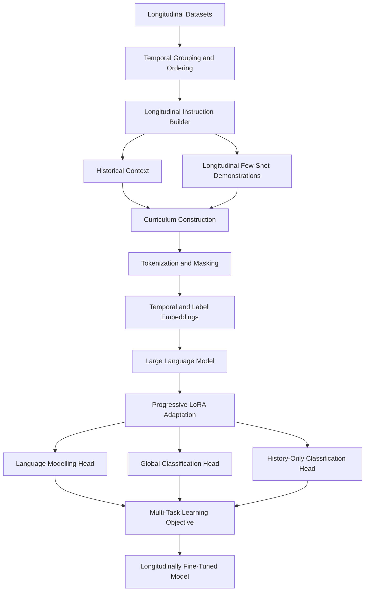

# LiFT: How to Enable In-Context Learning for Longitudinal Modelling

## Overview

**LiFT (Longitudinal Instruction Fine-Tuning)** is a framework for adapting Large Language Models (LLMs) to longitudinal modelling through temporally structured instruction fine-tuning, progressive curriculum learning, and history-aware multi-task learning. Unlike conventional instruction fine-tuning approaches that treat individual observations independently, LiFT incorporates historical context, temporal dependencies, and longitudinal few-shot demonstrations to model the evolution of information over time. Our framework investigates longitudinal modelling across multiple domains, including motivational interviewing, longitudinal stance detection, and emotional change detection.

---

## Key Features

- **Longitudinal Instruction Fine-Tuning:** Incorporates historical observations into structured instruction prompts.
- **Temporal-Aware Representations:** Integrates absolute, relative, and longitudinal timestep embeddings.
- **Longitudinal In-Context Learning:** Selects few-shot demonstrations from preceding observations within the same longitudinal group.
- **Progressive Curriculum Learning:** Sequentially trains across datasets with increasing target demonstration counts.
- **Adaptive LoRA:** Progressively expands LoRA capacity across curriculum stages.
- **Multi-Task Learning:** Combines language modelling and classification objectives.
- **History-Aware Learning:** Introduces an auxiliary classification head operating on historical representations.
- **Sequence-Consistent Batching:** Orders training examples according to longitudinal groups and timesteps.
- **Context-Aware Tokenization:** Supports dynamic history trimming and overlapping sequence chunking.
- **Checkpoint Recovery:** Supports stage-level and within-stage training recovery.
- **Model Export:** Supports LoRA adapters and merged language model exports.

---

## Framework Architecture



---

## Methodology

### 1. Longitudinal Instruction Construction

Each training instance is constructed using:

- Task-specific instructions.
- Historical observations.
- Explicit temporal indices.
- Longitudinal few-shot demonstrations.
- Current observation.
- Task-specific label space.
- Target output.

Historical observations are ordered chronologically within each longitudinal group.

Few-shot demonstrations are selected exclusively from previous observations belonging to the same group, enabling the model to learn from longitudinal context without accessing future observations.

### 2. Temporal Embedding Module

LiFT extends conventional token embeddings through additional learned representations.

| Embedding | Description |
|---|---|
| Absolute Position Embedding | Represents the token position within a sequence |
| Relative Temporal Embedding | Represents the token position relative to the sequence end |
| Timestep Embedding | Represents the longitudinal observation index |
| Label Embedding | Represents task-aware global label information |

These representations are combined and projected into the backbone hidden dimension before being integrated with the original token embeddings.

### 3. Progressive Curriculum Learning

The framework employs a three-stage curriculum with progressively increasing target demonstration counts and LoRA capacity.

| Stage | Dataset | Target Shots | LoRA Rank |
|---|---|---:|---:|
| Stage 1 | ANNoMI | 1 | 4 |
| Stage 2 | LRS | 2 | 8 |
| Stage 3 | TalkLife | 3 | 16 |

Training follows a continuous sequential learning strategy:

```text
Pretrained LLM
      |
      v
Stage 1: ANNoMI
      |
      v
Stage 2: LRS
      |
      v
Stage 3: TalkLife
      |
      v
Final LiFT Model
```

Each curriculum stage inherits the learned LoRA parameters and longitudinal wrapper weights from the preceding stage.

During rank expansion, previous adapter parameters are transferred into the expanded LoRA tensors, while gradient masking is applied to previously learned rank slices.

The actual number of demonstrations may vary depending on the availability of historical observations and token-budget constraints.

### 4. Multi-Task Learning Objective

The framework jointly optimizes multiple learning objectives:

$$
\mathcal{L}_{total} =
\lambda_{CE}\mathcal{L}_{CE}
+
\lambda_{LM}\mathcal{L}_{LM}
+
\lambda_{CLS}\mathcal{L}_{CLS}
+
\lambda_{HIST}\mathcal{L}_{HIST}
$$

| Objective | Description |
|---|---|
| Prompt Cross-Entropy Loss | Language modelling over non-history prompt tokens |
| Output Focal Loss | Label generation over output tokens |
| Classification Focal Loss | Global multi-task label prediction |
| History Classification Loss | Prediction from historical representations |

### 5. Sequence-Consistent Batching

Training instances are ordered according to:

- Longitudinal group identifier.
- Observation timestep.
- Sequence chunk position.

This batching strategy preserves temporal ordering within longitudinal groups and facilitates history-aware learning.

### 6. History-Aware Classification

In addition to the global classification head, LiFT introduces an auxiliary history-only classification head.

This component predicts the target class using pooled representations of historical observations, encouraging the model to learn informative representations from preceding context.

---

## Datasets

The current implementation supports three longitudinal classification datasets.

| Dataset | Task | Longitudinal Group | Classes |
|---|---|---|---|
| ANNoMI | Motivational interviewing talk-type classification | Topic | Neutral, Sustain, Change |
| LRS | Longitudinal stance change detection | Timeline ID | Stable, Switch |
| TalkLife | Moments of emotional change detection | User ID | Stable, Switch, Escalation |

### ANNoMI

Models motivational changes within therapeutic conversations using preceding client and therapist utterances.

### LRS

Models stance stability and switching across longitudinal sequences of posts.

### TalkLife

Models moments of emotional change within social media timelines.

- **0:** Stability
- **IS:** Switch
- **IE:** Escalation

Datasets must be obtained separately in accordance with their respective access requirements, ethical guidelines, and licences.

---

## Longitudinal Instruction Format

Each longitudinal instruction consists of:

- Task-specific instructions.
- Historical observations.
- Explicit temporal indices.
- Longitudinal few-shot demonstrations.
- Current observation.
- Task-specific label space.
- Target output.

The curriculum builder implements:

- Chronological sequence construction.
- In-group demonstration selection.
- Dynamic history truncation.
- Token-budget enforcement.
- Stable example identifiers.
- Cross-stage deduplication.
- Task-specific curriculum assignment.

Historical context and demonstrations are constructed exclusively from preceding observations within the same longitudinal group.

---

## Repository Structure

```text
LiFT-How-to-Enable-In-Context-Learning-for-Longitudinal-Modelling/
│
├── README.md
├── .gitignore
│
└── Llama8B/
    ├── ift_builder.py
    ├── ift_trainer.py
    ├── ift_trainer_fullmodelcopy.py
    ├── ift_s3_utils.py
    ├── sb2_np_s3.py
    └── driver_manifest_v2.py
```

### Implementation Details

| File | Description |
|---|---|
| `ift_builder.py` | Longitudinal instruction construction and curriculum generation |
| `ift_trainer.py` | Core longitudinal instruction fine-tuning implementation |
| `ift_trainer_fullmodelcopy.py` | Extended trainer with merged model exports and checkpoint recovery |
| `ift_s3_utils.py` | S3 storage, file management, and logging utilities |
| `sb2_np_s3.py` | Environment setup and training execution wrapper |
| `driver_manifest_v2.py` | Kubernetes/Kubeflow training job submission |

---

## Installation

### Clone the Repository

```bash
git clone https://github.com/Maria-Liakata-NLP-Group/LiFT-How-to-Enable-In-Context-Learning-for-Longitudinal-Modelling.git

cd LiFT-How-to-Enable-In-Context-Learning-for-Longitudinal-Modelling/Llama8B
```

### Requirements

- Python 3.10
- PyTorch
- CUDA-compatible GPU
- Hugging Face Transformers
- PEFT
- Accelerate
- S3-compatible object storage

### Environment Setup

```bash
python3.10 -m venv lift_env

source lift_env/bin/activate

pip install --upgrade pip setuptools wheel
```

Install a PyTorch version compatible with your CUDA environment.

Install the remaining dependencies:

```bash
pip install \
    "numpy<2.0" \
    pyarrow==15.0.2 \
    transformers==4.45.2 \
    accelerate==0.34.2 \
    datasets==2.20.0 \
    peft==0.13.2 \
    safetensors \
    pandas \
    fsspec \
    s3fs \
    boto3 \
    tensorboard \
    scikit-learn
```

For Kubernetes-based execution:

```bash
pip install kubernetes
```

---

## Configuration

### Backbone Model

The current implementation uses Llama-3.1-8B-Instruct.

```bash
export BASE_MODEL_NAME="meta-llama/Llama-3.1-8B-Instruct"
```

### Hugging Face Authentication

```bash
export HF_TOKEN="<your-huggingface-token>"
```

### S3 Storage Configuration

```bash
export FSSPEC_S3_ENDPOINT_URL="<your-endpoint>"
export FSSPEC_S3_KEY="<your-access-key>"
export FSSPEC_S3_SECRET="<your-secret-key>"

export IFT_DATASET_S3="s3://your-bucket/datasets"
export IFT_OUTPUT_S3="s3://your-bucket/outputs"
export IFT_NEWIFTDATA_S3="s3://your-bucket/curriculum"

export CURRICULUM_PREFIX_S3="$IFT_NEWIFTDATA_S3/ICL_curriculum_IFT_llama8b"
```

### Environment Configuration

```bash
export IFT_WORKDIR="/tmp/lift_run"
export IFT_SCRIPT_DIR="$PWD"

export BUILDER_CAP=4096
export MAX_TOKENS_PER_INPUT=4096
export TEMPORAL_MAX_LEN=4096
export TIMESTEP_MAX_VOCAB=4096

export STRICT_DEDUP=1
export SAVE_FULL_MODEL_EXPORTS=1
```

Authentication credentials should be supplied through environment variables or a secure secret-management system.

Credentials must never be committed to the repository.

---

## Dataset Preparation

The curriculum builder expects the following preprocessed CSV files:

```text
datasets/
├── annomi_train.csv
├── lrs17_train_train.csv
└── Talklife_filtered_IS_IE_O_train.csv
```

Alternatively, local dataset paths can be specified directly:

```bash
export PATH_ANNOMI="/path/to/annomi_train.csv"

export PATH_LRS="/path/to/lrs17_train_train.csv"

export PATH_MOOD="/path/to/Talklife_filtered_IS_IE_O_train.csv"
```

The current implementation supports local or S3-based dataset inputs, while curriculum and training outputs are stored in S3.

---

## Usage

### Step 1: Build the Longitudinal Curriculum

```bash
python ift_builder.py
```

The builder generates three curriculum files:

```text
ICL_curriculum_IFT_llama8b_stage1.jsonl
ICL_curriculum_IFT_llama8b_stage2.jsonl
ICL_curriculum_IFT_llama8b_stage3.jsonl
```

Additional curriculum statistics are stored in:

```text
builder_stats.json
```

### Step 2: Train the Model

Run the core trainer:

```bash
python ift_trainer.py
```

Alternatively, use the extended trainer for merged model exports and within-stage checkpoint recovery:

```bash
python ift_trainer_fullmodelcopy.py
```

Both the builder and trainer must use the same curriculum prefix.

### Step 3: Automated Execution

The execution wrapper supports three execution modes.

#### Build Only

```bash
export IFT_SCRIPT_DIR="$PWD"
export IFT_JOB_TYPE=build

python sb2_np_s3.py
```

#### Train Only

```bash
export IFT_SCRIPT_DIR="$PWD"
export IFT_JOB_TYPE=train

python sb2_np_s3.py
```

#### Build and Train

```bash
export IFT_SCRIPT_DIR="$PWD"
export IFT_JOB_TYPE=both

python sb2_np_s3.py
```

The wrapper creates a separate virtual environment and selects the extended trainer. Ensure CUDA-compatible PyTorch is available within the created environment.

Use a dedicated working directory, as the wrapper removes it following successful execution.

---

## Kubernetes and Kubeflow Execution

The framework supports GPU-based training through Kubeflow PyTorchJob resources.

Before submitting a training job, configure the following according to your computing environment:

- Kubernetes namespace.
- Persistent volume claim.
- GPU resource configuration.
- Storage credentials.
- Dataset paths.
- Output paths.
- Script paths.

Submit the training job:

```bash
python driver_manifest_v2.py
```

The deployment script contains environment-specific configuration that must be adapted before execution.

---

## Checkpointing and Training Recovery

LiFT supports two levels of training recovery through the extended trainer.

### Stage-Level Recovery

Training resumes from the most recently completed curriculum stage.

### Within-Stage Recovery

Training resumes from an uploaded checkpoint, including available:

- Model parameters.
- Optimizer state.
- Scheduler state.
- Random number generator state.
- Training step information.

Use the same S3 output path to resume an existing experiment and a different output path for independent experiments.

---

## Model Outputs

The extended trainer generates the following artifacts:

```text
outputs/
│
├── builder_stats.json
├── curriculum_state.json
├── training_report.json
├── LATEST.json
│
├── tokenizer/
│
├── stage_<index>_<tag>/
│   ├── checkpoints/
│   ├── lora_model/
│   ├── lora_model_best/
│   ├── wrapper_heads.pt
│   ├── wrapper_heads_best.pt
│   ├── full_model/
│   ├── full_model_best/
│   ├── wrapper_heads_full.pt
│   ├── wrapper_heads_best_full.pt
│   ├── BEST.json
│   ├── curriculum_summary.json
│   ├── eval_loss.json
│   └── inference_manifest.json
│
└── Final_Model/
    ├── lora_model/
    ├── wrapper_heads.pt
    ├── full_model/
    ├── wrapper_heads_full.pt
    ├── final_inference_manifest.json
    └── LATEST_FINAL.json
```

### Final Continuous Model

The `Final_Model/` directory contains the final model obtained through sequential training across all curriculum stages.

The framework supports:

- Parameter-efficient LoRA adapter exports.
- Merged causal language model exports.
- Temporal embedding weights.
- Global classification head weights.
- History-aware classification head weights.
- Inference configuration manifests.

The merged causal language model does not independently contain the custom longitudinal wrapper. The corresponding wrapper architecture and weights are required to reconstruct the complete LiFT model.

---

## Evaluation

The framework records training and evaluation artifacts, including:

- Training loss.
- Validation loss.
- Classification accuracy, when available.
- Macro-F1 score, when available.
- Best checkpoint information.
- Curriculum-stage statistics.
- Label distributions.
- Few-shot demonstration distributions.
- Token-length statistics.

For independent evaluation, group-disjoint or chronological data splits are recommended.

Predictive inference must operate without access to unknown ground-truth label information.

---

## Reproducibility

To support reproducible experimentation, the framework includes:

- Fixed random seeds.
- Explicit curriculum-stage configurations.
- Stable training example identifiers.
- Dataset and curriculum statistics.
- Checkpoint manifests.
- Training-state persistence.
- Model and tokenizer exports.
- Structured training reports.

---

## Research Applications

LiFT is designed to support research across longitudinal NLP tasks, including:

- Longitudinal text classification.
- Mental health timeline modelling.
- Moments of Change detection.
- Motivational interviewing analysis.
- Longitudinal stance detection.
- Temporal representation learning.
- Curriculum-based instruction fine-tuning.
- Multi-domain sequential learning.
- History-aware language modelling.
- Longitudinal in-context learning.

---

## Data Privacy and Responsible Use

This framework is intended for research purposes and is not a clinical diagnostic or therapeutic system.

Users must comply with the ethical, privacy, licensing, and data-access requirements associated with the underlying datasets and pretrained models.

Restricted datasets, identifiable user information, authentication credentials, and sensitive training artifacts must not be publicly redistributed.

---

## Citation

If you use LiFT in your research, please cite the associated publication.

Citation and BibTeX information will be added when available.

---

## Acknowledgements

This repository is maintained within the Maria Liakata NLP Group.

We acknowledge the open-source research community and the developers of PyTorch, Hugging Face Transformers, PEFT, Accelerate, and Kubeflow.
